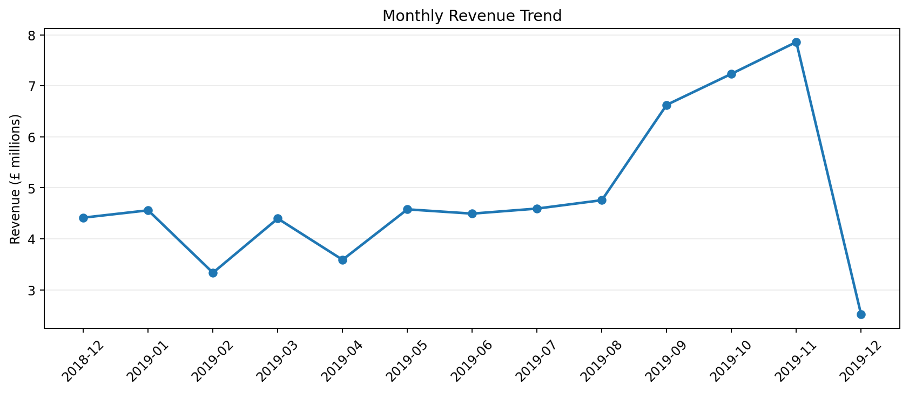
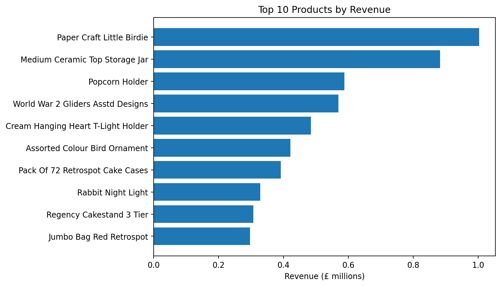
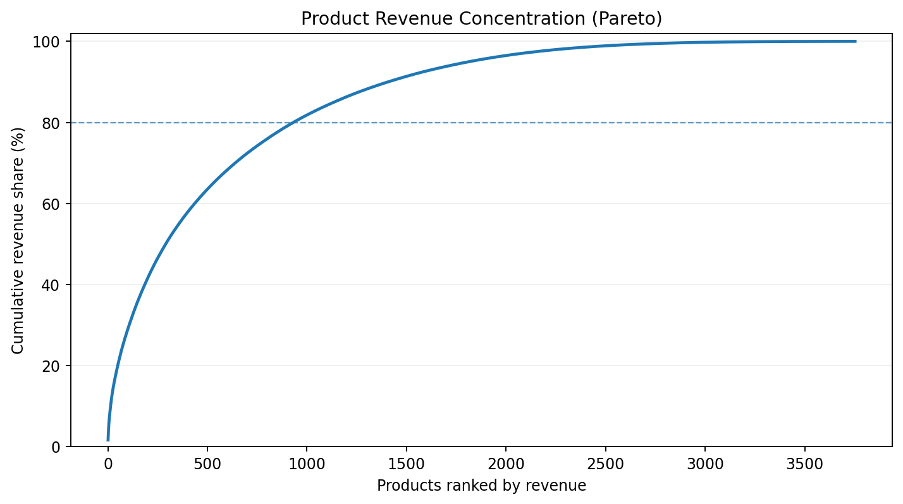
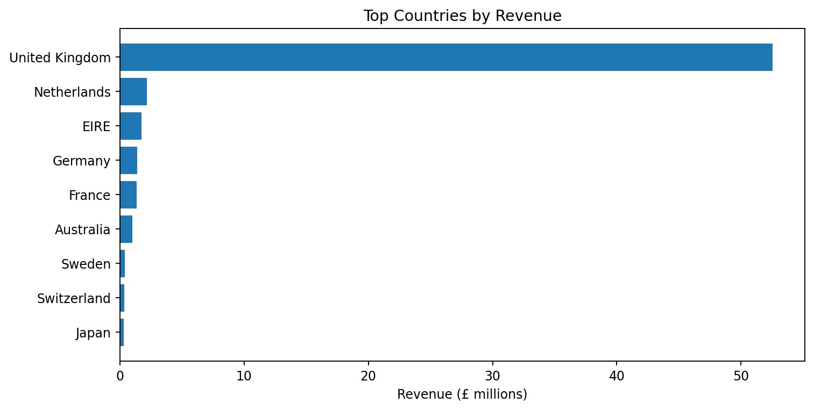
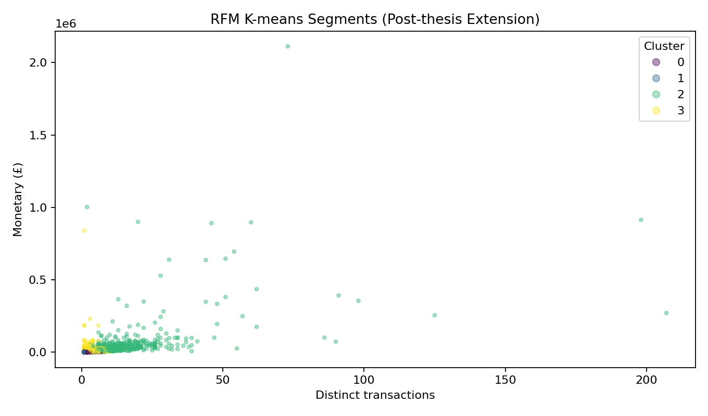

# E-Commerce Business Analytics | MSc Thesis

**Python · Pandas · Exploratory Data Analysis · Customer Segmentation · Tableau · Business Intelligence**

**Author:** Andre Mehangga Kurniawan  
**Degree:** MSc Data Analytics for Business — KEDGE Business School  
**Thesis date:** January 2026  
**Thesis title:** *Business Analytics: Applications of Python Programming with Business Data — An Empirical Study Using E-commerce Transaction Data*

> Transforming transactional data into interpretable business insights about sales performance, product concentration, market reach, and customer behavior.

**[View the portfolio notebook](notebooks/portfolio_walkthrough.ipynb)** · **[See reproducibility notes](docs/REPRODUCIBILITY_NOTES.md)**

## Project overview

This applied research project uses a historical UK e-commerce transactions dataset spanning **December 1, 2018 to December 9, 2019** to illustrate a Python-based analysis workflow and Tableau visualizations. The source file supplied with the project contains **536,350 transaction line items across 8 original columns**. Analyses include sales KPIs, trends over time, high-revenue products, product revenue concentration, international demand, and customer purchasing behavior.

### Questions explored

- How does sales performance vary over time, across products and across markets?
- Which products contribute disproportionately to overall revenue?
- What patterns emerge from customer purchasing frequency and revenue?
- How can reproducible Python workflows communicate insights to business stakeholders?

## Highlights from the reproducible portfolio refactor

| Metric | Value |
|---|---:|
| Original dataset rows | 536,350 |
| Positive, valid sales line items used in the refactor | 527,765 |
| Distinct sales transactions | 19,790 |
| Customers with known identifiers | 4,718 |
| Total positive-line revenue (not net of matched cancellations) | £62.97 million |

**Method note:** Numbers above were recomputed from the user-supplied source CSV with the documented script and **may not match all tables in the original thesis**, which uses some different analytical definitions. Revenue excludes negative/cancelled line items but does **not** independently match all cancellation pairs back to original purchases.

### Monthly revenue trends



### Product performance



### Revenue concentration



### Geographic revenue



## Project components

| Path | Description |
|---|---|
| `docs/` | Reproducibility documentation; full thesis PDF held back pending publication clearance |
| `archive/original_thesis_notebook.ipynb` | Preserved original Google Colab notebook (original file path requires adjustment) |
| `notebooks/portfolio_walkthrough.ipynb` | Portfolio-friendly notebook using saved summary outputs |
| `src/run_analysis.py` | Reproducible KPI, trend, product, geography, and revenue-tier analysis |
| `src/rfm_clustering_extension.py` | **New post-thesis** RFM clustering extension — separate from the submitted notebook |
| `figures/` | Recomputed plots from the supplied source data |
| `data/tableau_exports/` | Aggregates used to reconnect and explore Tableau workbooks |
| `tableau/` | Six Tableau `.twb` files, with local file paths replaced; reconnect data as needed |
| `data/raw/README.md` | Instructions to obtain the original source dataset |

## Methods and tools

**Data preparation:** date parsing, numeric validation, cancellation / negative-quantity flags, transaction revenue, and grouped aggregation.  
**Descriptive analytics:** revenue KPIs, month-by-month sales, top products, cumulative revenue shares, country-level revenue.  
**Customer analytics:** customer-level transactions and revenue; revenue-quantile tiers.  
**Visualization:** Matplotlib plots and Tableau dashboards.  
**Separate portfolio extension:** log-transformed RFM features, feature standardization, and K-means clustering (`k=4`); see notes below.

### Customer segmentation: important distinction

The **thesis PDF discusses four RFM clusters**, but the **original notebook supplied with this project implements low/medium/high revenue tiers using customer revenue quartiles**. Those are not the same method. For transparency, this repository preserves the original notebook and provides an **explicitly labeled post-thesis RFM K-means extension** in `src/rfm_clustering_extension.py`.



The extension's clusters were recomputed from the supplied CSV, but are **not claimed to reproduce the thesis's reported cluster table**. Cluster numbers have no intrinsic ordering.

## Run locally

Requires Python 3.10+.

```bash
python -m venv .venv
# Windows: .venv\Scripts\activate
# macOS / Linux: source .venv/bin/activate
pip install -r requirements.txt
```

1. Download the source dataset from [Kaggle — E-commerce Business Transaction](https://www.kaggle.com/datasets/gabrielramos87/an-online-shop-business).
2. Save the CSV as `data/raw/Sales Transaction v.4a.csv`.
3. Run from the repository root:

```bash
python src/run_analysis.py
python src/rfm_clustering_extension.py
python -m unittest discover -s tests
```

The scripts regenerate figures in `figures/` and CSV exports in `data/tableau_exports/`. The `notebooks/portfolio_walkthrough.ipynb` notebook can be viewed using the **pre-generated summary CSVs** even without the full raw dataset.

### Tableau dashboards

Tableau `.twb` workbooks store **visualization definitions, not their datasets**. Open with Tableau Desktop or Tableau Public and, if prompted, reconnect each data source to the matching CSV under `data/tableau_exports/` (see [`tableau/README.md`](tableau/README.md)). The supplied workbooks have been sanitized to remove machine-specific filesystem paths; workbook layout and connection compatibility have **not** been independently validated inside Tableau.

## Main business findings reported in the thesis

- Monthly revenue changes show variation over the observed period and suggest potential seasonal demand patterns. **Caution:** December 2019 contains data only through December 9, 2019, so the steep final-month decline on the plot reflects an incomplete month and must not be read as a full-month trend.
- Sales revenue is concentrated among a relatively small set of products.
- The United Kingdom dominates domestic sales, with additional international customers.
- Customers vary in activity and value; segmentation can help prioritize retention and targeting efforts.

See the PDF for discussion, caveats, and managerial interpretation. This is an academic case study using a single historical retailer dataset, not a production forecasting or causal-impact model.

## Data source and sharing

- **Source:** [Kaggle — E-commerce Business Transaction](https://www.kaggle.com/datasets/gabrielramos87/an-online-shop-business).
- The thesis identifies the dataset as CC0. **Please verify its current license on Kaggle before redistributing raw records**. The complete 43 MB original CSV is **not included** in this public repository package; its absence also avoids the GitHub browser uploader's per-file size restriction.
- The generated `customer_summary.csv` uses *new sequential surrogate IDs* rather than the original customer identifiers.
- The submitted thesis PDF is supplied for academic transparency; publication should comply with any KEDGE requirements.

## Reproducibility / limitations

The work uses one retailer and lacks demographic, margin/cost, marketing-channel, and causal-intervention data. See [`docs/REPRODUCIBILITY_NOTES.md`](docs/REPRODUCIBILITY_NOTES.md) for discrepancies between the thesis and the supplied notebook, and distinctions between preserved and newly authored code.

---

**Andre Mehangga Kurniawan** · [LinkedIn](https://www.linkedin.com/in/drekurniawan)
